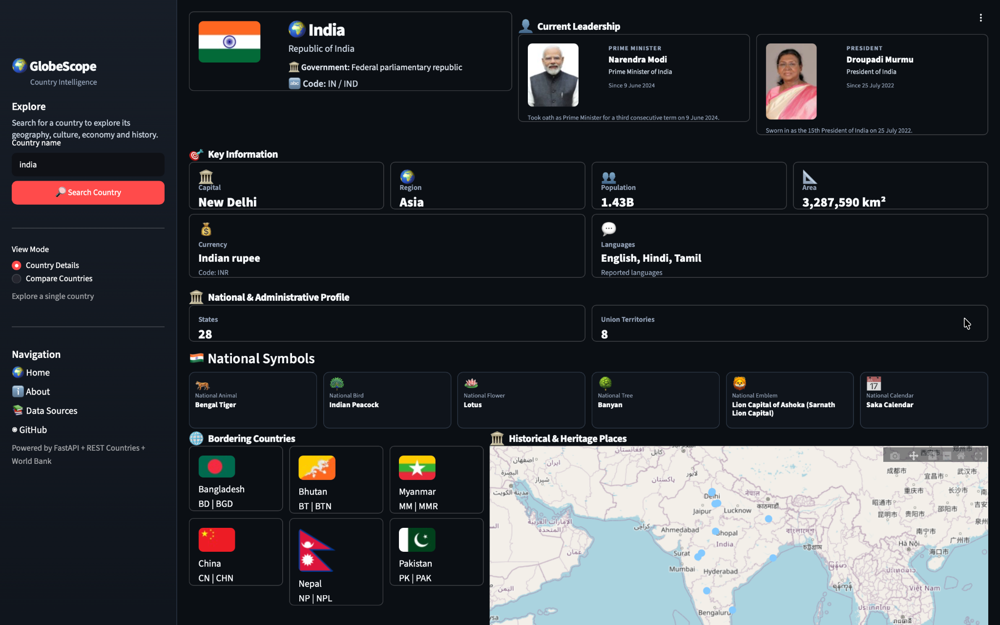
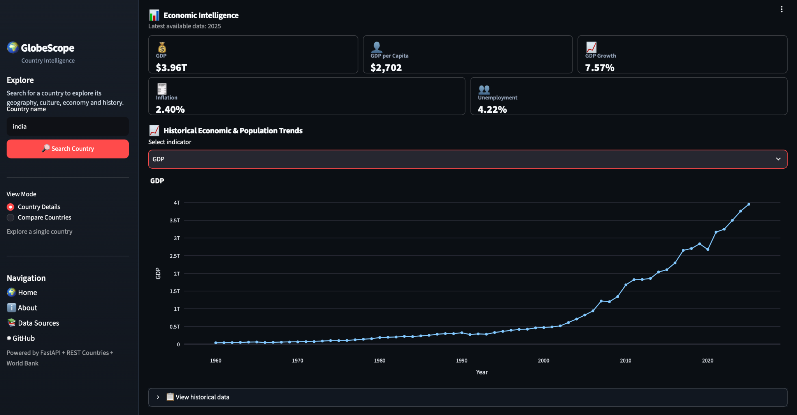
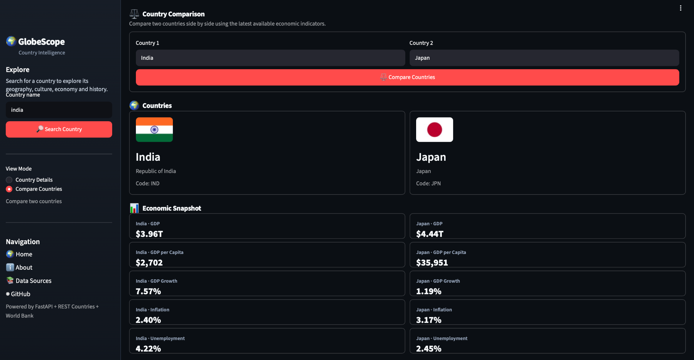
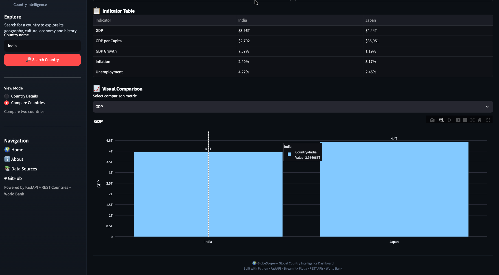
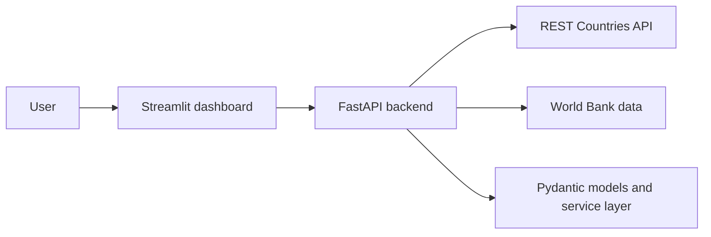

# GlobeScope — Global Country Intelligence Dashboard

Explore country profiles, economic indicators, geographic relationships and cross-country comparisons through an interactive dashboard backed by a FastAPI service.

<p>
  <a href="https://globescope-dashboard.onrender.com"><strong>Open live dashboard</strong></a>
  ·
  <a href="https://globescope.onrender.com/docs"><strong>Explore API documentation</strong></a>
  ·
  <a href="https://github.com/anshif20022kt/globescope"><strong>View source code</strong></a>
</p>



## Overview

GlobeScope is a full-stack country intelligence project. A Streamlit interface presents country information and visual analysis, while a FastAPI backend provides country-related endpoints and coordinates data retrieval from external sources.

The application is designed to make country-level information easier to explore and compare in one place.

## Features

- **Country explorer:** Search for a country and view its flag, official name, capital, region, population, area, currencies and languages.
- **Leadership and national profile:** Present leadership information and available national or administrative profile details, including states, union territories and national symbols where available.
- **Geographic context:** Explore bordering countries and map-based geographic or heritage information.
- **Economic intelligence:** Review indicators such as GDP, GDP per capita, GDP growth, inflation and unemployment, together with historical trend visualisations where data is available.
- **Country comparison:** Compare two countries side by side using economic indicators, summary tables and charts.
- **API-backed design:** Keep the Streamlit presentation layer separate from the FastAPI backend.

## Dashboard previews

### Country overview


### Economic intelligence



### Country comparison



### Comparison visualisation



## Architecture



The frontend reads the backend base URL from `BACKEND_URL`. The backend uses `REST_COUNTRIES_API_KEY` for the REST Countries integration.

## API endpoints

The FastAPI application exposes the following country routes:

| Method | Endpoint | Purpose |
|---|---|---|
| `GET` | `/countries/{country_name}` | Retrieve country information |
| `GET` | `/countries/{country_name}/profile` | Retrieve national and administrative profile information |
| `GET` | `/countries/{country_name}/heritage` | Retrieve heritage-place information |
| `GET` | `/countries/{country_name}/borders` | Retrieve bordering countries |
| `GET` | `/countries/{country_name}/economy` | Retrieve economic indicators |
| `GET` | `/countries/{country_name}/history` | Retrieve historical data |
| `GET` | `/countries/compare?country1=India&country2=Japan` | Compare two countries |

Interactive API documentation is available at [`/docs`](https://globescope.onrender.com/docs).

## Technology stack

| Technology | Role |
|---|---|
| Python | Application language |
| Streamlit | Interactive dashboard |
| FastAPI | Backend API |
| Uvicorn | ASGI server |
| Pydantic | Data models and validation |
| Requests | HTTP API calls |
| Pandas | Data handling |
| Plotly | Interactive charts |
| REST Countries API | Country profile data |
| World Bank data | Economic and historical indicators |

## Run locally

### 1. Clone the repository and install dependencies

```bash
git clone https://github.com/anshif20022kt/globescope.git
cd globescope
python -m venv .venv
source .venv/bin/activate
pip install -r requirements.txt
```

### 2. Start the FastAPI backend

In the first terminal, set your REST Countries API key and start the API:

```bash
export REST_COUNTRIES_API_KEY="your_api_key_here"
python -m uvicorn backend.app.main:app --reload
```

The API will be available at `http://127.0.0.1:8000` and its documentation at `http://127.0.0.1:8000/docs`.

### 3. Start the Streamlit dashboard

In a second terminal, activate the same virtual environment and run:

```bash
export BACKEND_URL="http://127.0.0.1:8000"
streamlit run frontend/app.py
```

Streamlit will print the local dashboard address in the terminal (normally `http://localhost:8501`).

## Deployment configuration

The public application uses two separate Render web services:

| Service | Environment variable | Value |
|---|---|---|
| `globescope` (FastAPI backend) | `REST_COUNTRIES_API_KEY` | Your private REST Countries API key |
| `globescope-dashboard` (Streamlit frontend) | `BACKEND_URL` | `https://globescope.onrender.com` |

Store secrets in the hosting provider's environment-variable settings. **Never commit API keys, `.env` files or Streamlit secrets to GitHub.**

> Render Free services can spin down after inactivity. The first request after a period of inactivity may take longer while the service starts.

## Project structure

```text
globescope/
├── backend/
│   └── app/
│       ├── api/
│       │   └── countries.py
│       ├── models/
│       │   ├── country.py
│       │   ├── heritage.py
│       │   └── leadership.py
│       ├── services/
│       │   ├── country_service.py
│       │   ├── heritage_service.py
│       │   └── leadership_service.py
│       └── main.py
├── frontend/
│   └── app.py
├── docs/
│   └── images/
├── requirements.txt
└── README.md
```

## Data and limitations

Country and economic information depends on the coverage, availability and update schedule of the upstream data providers. Values and historical coverage may differ by country and indicator.

## Author

**Muhammed Anshif KT**  
[GitHub](https://github.com/anshif20022kt) · [LinkedIn](https://www.linkedin.com/in/muhammedanshifkt/)
